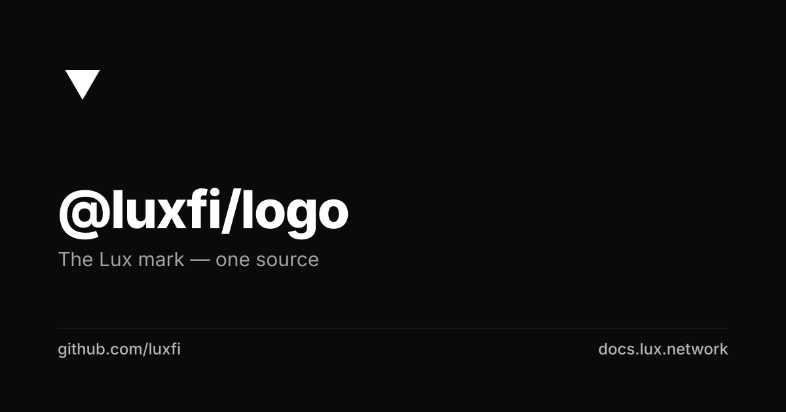

<p align="center">
  
</p>

# ▼ Logo

Universal brand mark. White downward triangle on dark.

## Install

```bash
pnpm add @luxfi/logo
```

## Usage

```tsx
import { Logo, Favicon, Wordmark } from '@luxfi/logo'

<Logo size={64} />
<Logo variant="mono" />
<Logo variant="white" />
<Wordmark size={128} />
<Favicon />
```

## Which mark goes on which surface

**Every Lux surface wears the full `LUX` wordmark.** `lux.exchange` is the single
exception — it wears the `LX` mark. A new surface gets the wordmark unless someone
says otherwise.

That holds for headers and for square slots alike. In a square, the wordmark is
letterboxed — scaled and centred with the leftover as padding. It is never
stretched to fill, and never cropped down to `LU`.

> The `LX` mark does not exist in this package yet. Nothing in the fleet draws
> the two letters as artwork — where you see "LX" it is either a name string or
> the rename of Uniswap's `UniswapX` protocol. It has to be drawn before
> lux.exchange can wear it. Do not cut it out of the wordmark: an `LX` lockup is
> a kerning decision, not a crop.

## SVG Functions

```ts
import {
  getColorSVG, getMonoSVG, getFaviconSVG,
  getWordmarkSVG, getWordmarkAdaptiveSVG, getWordmarkSquareSVG,
} from '@luxfi/logo'

getColorSVG()            // white ▼ on transparent
getMonoSVG()             // outline ▼
getFaviconSVG()          // ▼ keyed for the tab — reads on light and dark
getWordmarkSVG()         // LUX as paths, white
getWordmarkAdaptiveSVG() // LUX, taking contrast from the ground it lands on
getWordmarkSquareSVG()   // LUX letterboxed into a square, for icon slots
```

## Variants

| Variant | Use |
|---------|-----|
| `color` | White ▼ — default, for dark backgrounds |
| `mono` | Outline ▼ — for print, light backgrounds |
| `white` | Same as color — explicit white fill |
| `menuBar` | Uses `currentColor` — adapts to OS theme |
| `favicon` | ▼ in white with a dark keyline, no container — browser tab |

## Icon slots

A tab, a home screen and an app switcher all want a square. Rather than each
surface drawing its own, generate the set from this package:

```bash
npx lux-icons apps/web/public/brand/lux
# → icon.svg, android-chrome-192x192.png, android-chrome-512x512.png, apple-touch-icon.png
```

`icon.svg` is transparent and follows the tab's colour scheme. The PNGs get an
explicit ground, because Android and iOS composite them onto whatever they like.

## Over the CDN

For consumers that cannot import — a gateway's `chains.json`, a runtime
`brand.json` — the published `svg/` directory is addressable on jsDelivr:

```
https://cdn.jsdelivr.net/npm/@luxfi/logo@1.0.9/svg/lux-wordmark.svg
https://cdn.jsdelivr.net/npm/@luxfi/logo@1.0.9/svg/lux-wordmark-square.svg
https://cdn.jsdelivr.net/npm/@luxfi/logo@1.0.9/svg/lux-favicon.svg
https://cdn.jsdelivr.net/npm/@luxfi/logo@1.0.9/svg/lux-icon-white.svg
```

Pin the version. `cdn.lux.network` is not a home for these — nothing serves it.

## Brand Override

This package exports the default ▼ mark. White-label products override via their brand package (`@<tenant>/brand`, `@zooai/brand`, etc.) which provides org-specific logos.

## License

All rights reserved.

## Animated & interactive

The mark ships a self-contained, **pure-CSS animated SVG** — a load animation, a
hover flourish, and a press squash, with **zero JavaScript**. Inline it into the DOM
(not via ``) for the hover/press interactions to fire. Honors `prefers-reduced-motion`.

```tsx
// React — one-line interactive embed
import { Logo } from '@luxfi/logo';
<Logo variant="animated" size={64} />
```

```ts
// Vanilla / any framework
import { getAnimatedSVG, getAnimatedDataUrl } from '@luxfi/logo';
el.innerHTML = getAnimatedSVG();   // interactive (inline in the DOM)
img.src = getAnimatedDataUrl();    // load animation only (fine in )
```

```html
<!-- Raw SVG over CDN — load animation in ; inline the file for hover/press -->

```
